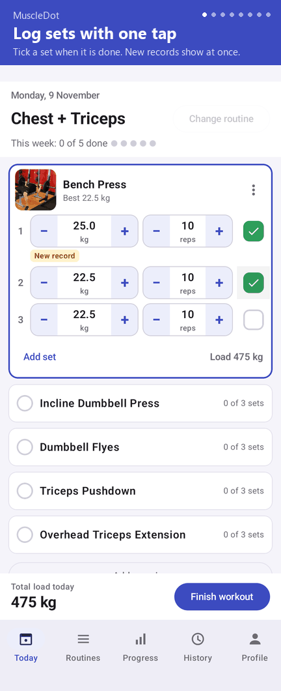

# MuscleDot

An offline workout tracker for Android. Plan your week, log each set with one tap, and watch your numbers go up.

<p align="center">
  
</p>

## What it does

- **Today.** Opens on today's routine. Change the weight or reps with + and −, and tick each set as you finish it.
- **Records.** A new max weight or best set is marked the moment you log it, and listed again when you finish.
- **Routines.** Build your own routines and give each day of the week a routine or a rest day.
- **154 exercises.** Each one has pictures. Search by name or filter by muscle group. Weights, body-weight, reps-only and cardio exercises are all covered.
- **Progress.** Charts for every exercise and every routine, weekly totals for load and cardio, and your body weight over time.
- **History.** Every finished workout is kept. Open any day to look back or correct it.
- **Private.** No account and no ads. The app does not ask for the internet permission, so nothing can leave your phone.
- **Backup.** Export everything to one file and import it on a new phone.
- **Light and dark.** Follows your phone's theme.

## Get the app

There is no Play Store release yet. To try it, build it yourself. It runs on Android 8.0 and newer.

1. Install [Android Studio](https://developer.android.com/studio).
2. Clone this repo: `git clone https://github.com/harpalnain/MuscleDot.git`
3. Open the folder in Android Studio and press **Run** with a phone or an emulator connected.

Or build the APK from the command line (needs a JDK; the one that comes with Android Studio works):

```
./gradlew :app:assembleDebug
```

The file lands in `app/build/outputs/apk/debug/app-debug.apk`.

## Tests

```
./gradlew :app:testDebugUnitTest           # fast, runs on your computer
./gradlew :app:connectedDebugAndroidTest   # runs on an emulator or a phone
```

The second command removes the app from the device when it finishes. Run it on an emulator, not on a phone that holds your real workouts.

## How it is built

- Kotlin and Jetpack Compose (Material 3)
- Room for the database on the phone
- Navigation Compose for moving between screens
- kotlinx.serialization for backup files

The code is in `app/src/main/java/com/example/fit`:

| Folder | What is in it |
|---|---|
| `domain` | The models and the rules, such as what counts as a record |
| `data` | The database and backup files |
| `ui` | The screens, one folder each |

Other folders:

| Folder | What is in it |
|---|---|
| `tools/exercise-pack` | Builds the exercise list and its pictures |
| `tools/readme-gif` | Builds the GIF at the top of this page |
| `docs` | The design notes and the plan the app was built from |

## Credits

The exercise list and pictures come from [free-exercise-db](https://github.com/yuhonas/free-exercise-db), which is in the public domain.
